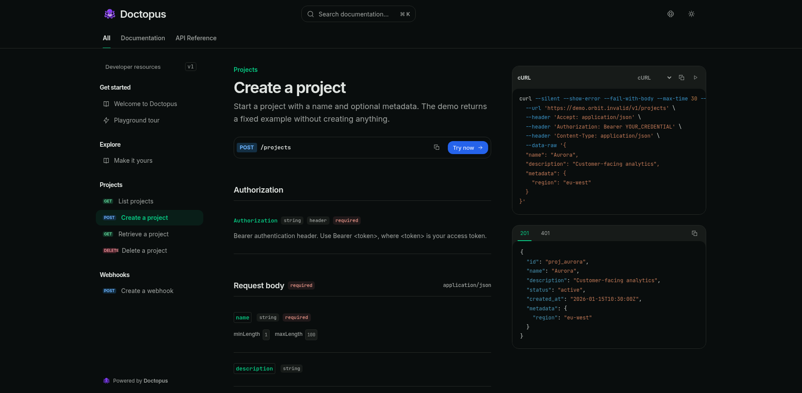
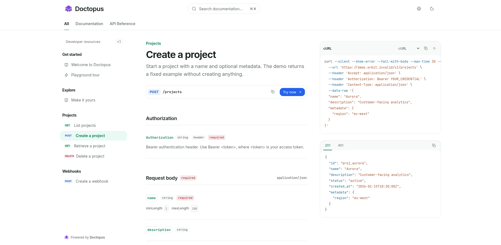
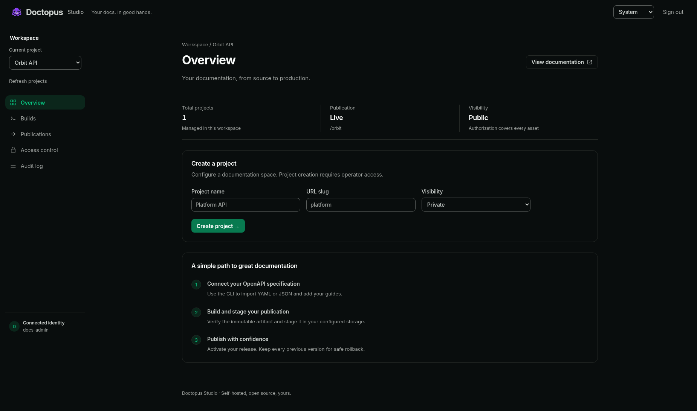
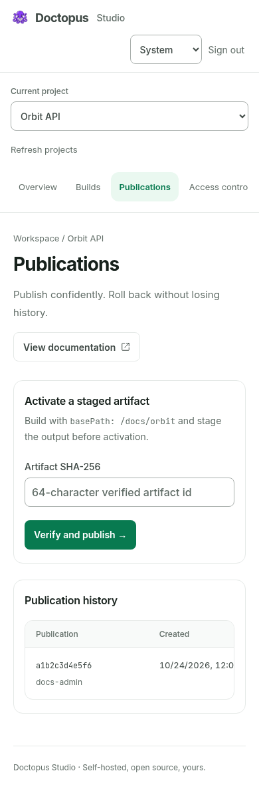

# Doctopus interface

The documentation reader and Studio share locally hosted typography, semantic light/dark colors and a flat workspace. The reader keeps navigation adjustable and places request/response examples alongside endpoint contracts. Studio groups project, build, publication and access workflows in readable forms and tables.

These screenshots use the local mock demo and illustrative Studio fixtures. The current design tokens and component guidance are in [DESIGN.md](../../DESIGN.md); interaction and preference behavior is described in [Workspace layout](../reader-layout.md).

## Documentation

## Studio

