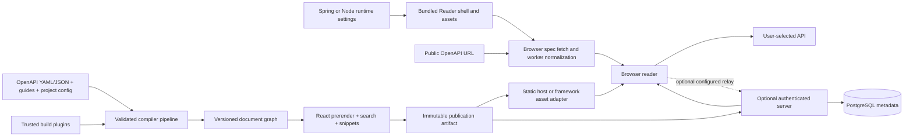

# Architecture and engineering design

Status: proposed technical baseline for the [product contract](01-product.md). Validate choices with the early vertical slice and performance fixtures before stabilizing public APIs. Implementation is underway; the [progress record](04-progress.md) distinguishes existing packages and verified behavior from remaining interfaces and launch gates.

## 1. Architecture decisions

Use a TypeScript modular monolith with separately deployable reader artifacts and background build workers. Keep domain logic independent of React, HTTP frameworks, databases, and framework adapters. This provides clear boundaries without starting with distributed-service complexity.

| Concern           | Decision                                                                                          | Reason and trade-off                                                                                            |
| ----------------- | ------------------------------------------------------------------------------------------------- | --------------------------------------------------------------------------------------------------------------- |
| Workspace         | npm workspaces, one root lockfile, dependency-boundary checks                                     | Familiar contributor workflow and reproducible installs; introduce task caching only after measured need        |
| Language/runtime  | Strict TypeScript, supported Node LTS; Node 24 is the initial tooling baseline                    | Shared contracts and mature tooling; published runtime support is verified in a CI matrix                       |
| Reader UI         | React, semantic HTML, CSS custom properties, accessible headless primitives                       | Original visual design with reusable behavior; keep styling tokens stable and headless dependencies replaceable |
| Build and routing | Vite-based build, pre-rendered route manifest, lazy route enhancements                            | Fast tooling and deploy-anywhere static artifacts; the project owns its static rendering and subpath behavior   |
| Optional server   | Fastify with schema-validated HTTP contracts                                                      | Small, well-typed server boundary with plugin lifecycle support                                                 |
| Validation        | JSON Schema 2020-12 configuration contracts; Zod at TypeScript boundaries where useful            | Language-independent plugin/configuration schema; compatibility tests prevent schema drift                      |
| Spec parsing      | Maintained OpenAPI/JSON Schema libraries behind an internal adapter                               | Avoid a homegrown standards parser; prove 3.0/3.1 semantics with fixtures before selecting/pinning libraries    |
| Content           | unified/remark/rehype pipeline, sanitized Markdown, explicitly trusted MDX                        | Rich authoring with clear code-execution trust boundaries                                                       |
| Search            | Local prebuilt search shards behind a search-provider interface                                   | No mandatory search service; benchmark an existing engine before deciding whether a custom index is justified   |
| Persistence       | PostgreSQL plus versioned SQL migrations and a typed query layer such as Kysely                   | Transparent storage and predictable migrations; no database in static mode                                      |
| Jobs              | PostgreSQL-backed job queue behind a port                                                         | Avoid required Redis for the baseline; isolated workers handle build resource limits and cancellation           |
| Artifacts         | Immutable directories locally, optional S3-compatible object storage                              | Same publish protocol for small installs and scaled deployments                                                 |
| Tests             | Vitest, Testing Library, Playwright, axe-core, framework-native tests                             | Exercise domain correctness, UI behavior, accessibility, and deployed integration paths                         |
| Quality           | Prettier, ESLint flat configuration, typescript-eslint strict/type-aware rules, dependency policy | Formatting is automatic; architecture and correctness rules enforce maintainability                             |
| Releases          | Changesets for JS packages; coordinated adapter versions and signed Git tags                      | Explicit release notes and semver; Java artifacts remain independently versioned against a compatibility table  |
| Operations        | Structured redacted logs, OpenTelemetry, Prometheus-compatible metrics, readiness endpoints       | Optional observability with no mandatory hosted telemetry                                                       |

Pin exact dependency versions and container/action digests when implementation starts, commit lockfiles, and automate reviewed upgrades. Do not select a version solely because it is newest. Document adoption/replacement decisions as short ADRs.

## 2. Data flow and deployment boundaries



Direct framework mode serves the bundled shell and assets, then fetches and normalizes one bounded self-contained specification in a browser worker. Runtime Spring properties or Node options configure it without a documentation project file or CLI build.

For optional compiled publications, the compiler runs at build time. The reader consumes prepared content and lazy modules; that mode does not parse an entire large OpenAPI document on every page load. A small development preview may compile on demand, but uses the same normalization and rendering code.

The optional server manages projects, authorization, build scheduling, publication pointers, and audit records. It serves completed artifacts. A failed or cancelled build cannot replace the currently published artifact.

## 3. Workspace and dependency rules

Proposed layout:

```text
apps/
  reader/                 React routes and static rendering entrypoints
  studio/                 Optional admin UI; editor arrives after 1.0
  server/                 HTTP composition, authentication, publish endpoints
  worker/                 Isolated build job executable
packages/
  contracts/              Versioned schemas, portable types, compatibility rules
  spec/                   Parsing, reference resolution, normalization, diagnostics
  content/                Markdown/MDX compilation and authored content graph
  compiler/               Pipeline orchestration, manifests, incremental cache
  theme/                  Tokens and theme validation
  ui/                     Accessible reader components and supported slots
  explorer/               Request serialization, auth state, response rendering
  snippets/               Generator interface and maintained language generators
  search/                 Index production and provider interface
  plugin-sdk/             Plugin manifests, hooks, test harness, compatibility checks
  domain/                 Project, publication, policy, and audit use cases
  storage/                Database/artifact/queue port implementations
  cli/                    init, dev, build, validate, doctor, diff, export
  test-fixtures/          Specs, guide corpus, mock APIs, golden manifests
integrations/
  node/                   Express and Fastify mounting adapters
  java/                   Static asset JAR and servlet/resource integration
  spring-boot/            Starter/autoconfiguration and sample applications
examples/                 Standalone, private server, Java and Node integrations
deploy/                   Docker, Compose, reverse proxy and Kubernetes examples
docs/                     User, contributor, operator and design documentation
```

Dependency direction: contracts and domain are at the bottom; implementations depend on ports; applications assemble implementations. Core packages cannot import applications or concrete storage. Spec parsing cannot import React. UI does not read databases. Framework adapters cannot reimplement compiler behavior.

Enforce package `exports`, avoid private deep imports, reject cycles, and check import boundaries in CI. Keep browser modules free of Node-only code. Public API and bundle-size changes require deliberate review.

Use feature-oriented modules within packages with colocated tests and explicit entrypoints. Prefer functions and discriminated unions over inheritance-heavy frameworks. Shared packages should represent a real stable responsibility rather than become a miscellaneous utilities directory.

## 4. Compiler and intermediate representation

Pipeline stages:

1. Load configuration, resolve its schema version, validate plugin compatibility, and calculate limits/trust policy.
2. Read allowed input sources. Parse YAML with bounded alias expansion and input size; parse JSON with location-aware diagnostics where practical.
3. Validate the OpenAPI version and dialect. Build a reference graph with canonical identities, cycle handling, source maps, and bounded external fetches.
4. Normalize APIs, versions, operations, schemas, navigation, guides, security schemes, and examples into a versioned document graph.
5. Validate examples and content relationships, run documentation quality rules, and compute diagnostics with stable rule identifiers.
6. Generate language snippets, static HTML, route data, assets, and search shards. Resolve all links against the configured base path and visibility policy.
7. Write a manifest with source/config/plugin fingerprints, graph schema version, output hashes, redirects, warnings, and build tool version.
8. Verify artifact integrity and required outputs, then atomically mark the artifact ready for publication.

The graph stores references to schema nodes rather than duplicating recursive structures. Example generation has depth and size bounds. `operationId` is useful metadata but not assumed globally unique; stable internal identity includes API/version/path/method. Explicit slug mappings preserve public URLs across renames.

Cache keys include content digests, relevant configuration, compiler version, plugin versions, and declared plugin inputs. Build the dependency graph so changing a shared schema invalidates all dependent operations. Never reuse cache entries across authorization partitions unless the data is proven public. Plugins with undeclared inputs are non-cacheable.

Remote spec inputs require explicit refresh in reproducible mode and are stored with digest metadata. A frozen build must fail if a required input is absent or differs from the declared digest. Generated artifacts should be byte-reproducible where feasible; exclude timestamps from content hashes and keep provenance timestamps in a separate envelope.

## 5. Plugin model

Separate three extension classes because they have different trust and deployment properties:

| Class                  | Examples                                                                 | Execution and permissions                                                                            |
| ---------------------- | ------------------------------------------------------------------------ | ---------------------------------------------------------------------------------------------------- |
| Build plugin           | Spec source, content transform, snippet generator, search index provider | Executes during trusted build; manifests declare inputs, compatible APIs, and requested capabilities |
| Reader/theme plugin    | Custom callout, interactive visualization, theme slot                    | Bundled React/browser code; full page-origin privileges, explicit operator trust and CSP review      |
| Host/framework adapter | Spring starter, Express middleware, Fastify plugin                       | Native framework lifecycle; mounts immutable assets/spec inputs and maps host configuration          |

Initial plugin manifest sketch, not a stable API:

```json
{
  "name": "@example/docs-plugin-java-snippets",
  "version": "1.0.0",
  "pluginApi": "^1.0.0",
  "kind": "build",
  "entry": "./dist/index.js",
  "capabilities": ["generate:snippets"],
  "configurationSchema": "./schema.json"
}
```

Define typed hooks such as `loadSpec`, `transformGraph`, `generateSnippets`, and `emitArtifacts`. Each hook receives immutable input and returns validated output/diagnostics. Assign deterministic ordering, explicit dependency declarations, namespaced asset paths, timeouts, cancellation signals, and failure policy. Required-plugin failure fails the build; optional-plugin omission must be declared and visibly reported.

Provide a plugin SDK, fixtures, compatibility tests, starter templates, documentation, and a conformance command. Reject unsupported plugin API ranges early. Stabilize v1 only after implementing several first-party plugins using the public interfaces.

Capability declarations are **not** a JavaScript security sandbox. Trusted local build plugins have the build process's permissions. Hosted builds run in separate restricted OS/container processes with CPU/memory/time limits, no host secrets, read-only source mounts, bounded output directories, and explicit outbound policy. Node workers or `vm` alone are insufficient isolation. Installing an untrusted server plugin into the request process is outside 1.0.

The current [operator-only isolated runner](../isolated-builds.md) implements the offline local-Docker boundary, observed cgroup/mount controls, independent cleanup watchdog, frozen archive export and verified activation. It does not expose a source-upload API, distributed job queue or configurable outbound access. Hidden files are excluded; visible source must be prepared without secrets. Dedicated build-host hardening and independent isolation review remain release requirements.

A registry/catalog is optional discovery metadata, not a required runtime service. Installation supports local packages and mirrored registries for air-gapped deployments. Display publisher, provenance, support status, and permissions; never execute a plugin merely because a docs project mentions it.

## 6. Java and Spring integration

The default simple setup is direct mode: the core JAR bundles Reader assets and their SHA-256 inventory; Spring binds a browser-visible spec URL and branding from `application.yml` or properties. MVC and WebFlux serve the shell, assets and deep-link routes using the active context path and existing host security. The browser parses self-contained OpenAPI in a bounded worker and uses the shared Reader without a documentation build, project config file, Node runtime or database in the Java application.

Optional publication mode accepts a verified filesystem directory and optional trusted artifact digest. It preserves compiled guides, versioned documents, reviewed build extensions and immutable publication guarantees. Directory mode and direct branding/spec settings are mutually exclusive. Publisher configuration files remain specific to this advanced build workflow.

## 7. JavaScript and other framework integrations

Express and Fastify expose the same direct-mode URL, title, description, prepared theme, initial layout/appearance and branding URL options. Assets come from the installed Reader package. Authentication and request quotas apply to the UI tree; the application owns the raw spec endpoint and API routes. Fastify registration prefixes and explicit proxy paths feed the public mount. Direct-mode hosts never fetch the spec server-side.

Both Node adapters retain the verified-directory option for full compiled sites. Other runtimes can serve static publications today; additional native adapters remain future work. Direct configuration is validated in shared TypeScript contracts and equivalent Java configuration, with cross-framework and installed-consumer checks.

## 8. Server domain, storage, and publication

Core entities: `Project`, `ApiVersion`, `SourceRevision`, `Build`, `Artifact`, `Publication`, `Identity`, `RoleBinding`, `PublishToken`, and append-only `AuditEvent`. Operational secrets are stored using an operator-configured secret backend or encrypted at rest with an externally managed key; hashing is used for locally verified API tokens.

Separate artifact creation from publication. A build transitions through queued, running, succeeded/failed/cancelled states. A publication references one verified artifact and a source revision. Update the active pointer transactionally, preserving the prior pointer for rollback. Use idempotency keys for publish requests and leased jobs with bounded retries. Artifact upload completes before its pointer can become active.

Prevent concurrent publishers from overwriting newer releases with stale output using revision checks. Keep redirects and search indexes inside the same publication version as page content. Garbage collection deletes only unreferenced artifacts outside the retention window and must coordinate with in-flight builds, active readers, and backup snapshots.

Document PostgreSQL migration and rollback policy. Use expand/migrate/contract for changes that need rolling upgrades. Take consistent metadata/artifact backups; test restore on a fresh deployment. A schema rollback is not automatically safe merely because a prior container image exists.

The first supported production topology is a single application instance with PostgreSQL and local durable artifact storage. Multiple replicas require shared object storage, coordinated queue leases, consistent auth/session keys, and publication cache invalidation. Add and test that topology before advertising high availability.

## 9. Security and privacy design

- Authenticate private requests at the serving boundary, including JSON route data, search indexes, assets, source specs, downloads, and caches. Build separate public/private artifacts or protect the entire private artifact; hiding navigation is not authorization.
- Namespace caches by project, publication, and authorization policy. Prevent CDN/shared-cache leaks with correct cache controls and vary behavior. Test direct URL access after role removal and sign-out.
- Use secure, HttpOnly, SameSite session cookies, CSRF protection for mutations, restrictive CORS, validated OAuth state/PKCE, OIDC issuer/audience verification, token expiry, and key rotation.
- Model reader, editor, publisher, and administrator permissions explicitly. Bind identities through immutable provider subject IDs. Audit privilege changes, publication, token lifecycle, and configuration updates.
- Treat specs, examples, Markdown, and filenames as untrusted input. Sanitize rendered HTML, escape generated scripts, reject traversal/zip-slip/symlink escapes, constrain YAML expansion and recursive schemas, and limit resources.
- MDX and custom React components execute trusted code. Do not compile arbitrary uploaded MDX in the server request process. Content Security Policy and HTML sanitization do not make arbitrary MDX safe.
- For remote imports and the API relay, deny loopback, link-local, cloud metadata, and private network destinations by default. Revalidate every redirect and resolved address, defend against DNS rebinding, restrict schemes/ports/methods, and enforce egress policy at the network layer. Private destinations require explicit operator-approved configuration.
- The relay is disabled by default. It must never be an open proxy; apply project authorization, destination allowlists, rate/size/time limits, credential redaction, and user-visible destination confirmation.
- Split browser-public OAuth client IDs from server secrets. Never pass server credentials to client bundles. Preview jobs for forks receive no deployment secrets or privileged cloud identity.
- Self-host fonts/assets, disable telemetry by default, and document data retention. Analytics omit API payloads, tokens, query secrets, and sensitive search terms unless a deliberate privacy-reviewed policy permits them.
- Publish a threat model, vulnerability reporting route, dependency policy, and security support window. Run authorization-leak, XSS, SSRF, malformed-spec, and plugin-isolation tests before 1.0.

## 10. Performance and resilience implementation

Pre-render useful content and hydrate only interactive regions. Split explorer, syntax grammars, large schemas, and admin tools into deferred bundles. Send only route-relevant graph fragments. Cache immutable assets with content hashes; keep publication manifests revalidatable.

Build and query large search indexes off the UI thread, load shards by API/version/locale, and provide bounded-memory behavior. Test both cold and warm paths. Benchmark windowed schema rendering while preserving anchors and an accessible reading mode.

Use bounded worker concurrency based on memory as well as CPU. Cache source transformations, invalidate via dependency edges, and avoid unbounded promise fan-out. Report stage timings and peak memory in build output.

The reader remains usable when optional feedback, telemetry, AI, or admin services fail. Builds have timeouts, cancellation, diagnostic output, and recoverable failure states. Health endpoints distinguish process liveness from readiness to serve the current publication. Test shutdown, interrupted upload, database loss, stale queue leases, and rollback behavior.

## 11. Developer experience and testing boundaries

The CLI validates configuration and reports corrective errors before starting long work. `dev` watches relevant inputs and preserves browser state. `doctor` runs offline-capable validation by default; network link checking is an explicit mode with limits. Provide JSON output and stable exit codes for CI.

Testing layers:

- Unit/property tests for graph transformations, reference cycles, parameter serialization, permissions, and version compatibility.
- Golden fixture tests for YAML/JSON equivalence, OpenAPI 3.0/3.1 behavior, output manifests, snippets, and redirects. Review snapshots deliberately.
- Browser tests for guide reading, search, theme/version switching, explorer requests, auth, mobile layouts, and accessible navigation.
- Integration tests with real PostgreSQL, filesystem/object storage, mock OIDC, and a controlled API server; fault injection for publish/restore.
- Java JUnit/framework tests and Node adapter tests using packaged release artifacts, not source-only imports.
- Performance and visual regression suites on stable fixtures with explicit baseline updates and evidence attached to changes.

Coverage is a diagnostic rather than proof of quality. Require meaningful branch coverage for critical domain/security behavior and reject tests that merely repeat implementation details. Enforce no skipped critical-path checks on release candidates.

## 12. Decisions to resolve during implementation

| Decision                 | Default to proceed with                             | Evidence needed before freezing                                              |
| ------------------------ | --------------------------------------------------- | ---------------------------------------------------------------------------- |
| OpenAPI parser/resolver  | Existing maintained library behind adapter          | Correctness, dialect support, licensing, adversarial fixture results         |
| Search engine            | Embedded static index provider                      | Ranking quality, cold/warm latency, index size on 10k-page corpus            |
| Java compatibility split | Separate adapters if necessary                      | Actual Boot 3/4 + Java baseline builds and packaged sample tests             |
| Theme primitives         | Accessible headless components + project tokens     | Keyboard/screen-reader testing, styling flexibility, bundle cost             |
| Multi-replica support    | Single-instance production first                    | Consistent publication/auth behavior and failover/load tests                 |
| Licensing                | Propose Apache-2.0 for core and first-party plugins | Maintainer adoption and dependency/asset license audit before public release |

These are planned engineering checkpoints, not prerequisites that block drafting the plan. Record evidence in ADRs as the corresponding milestone is implemented.
